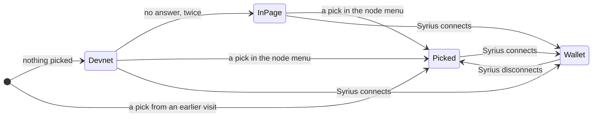
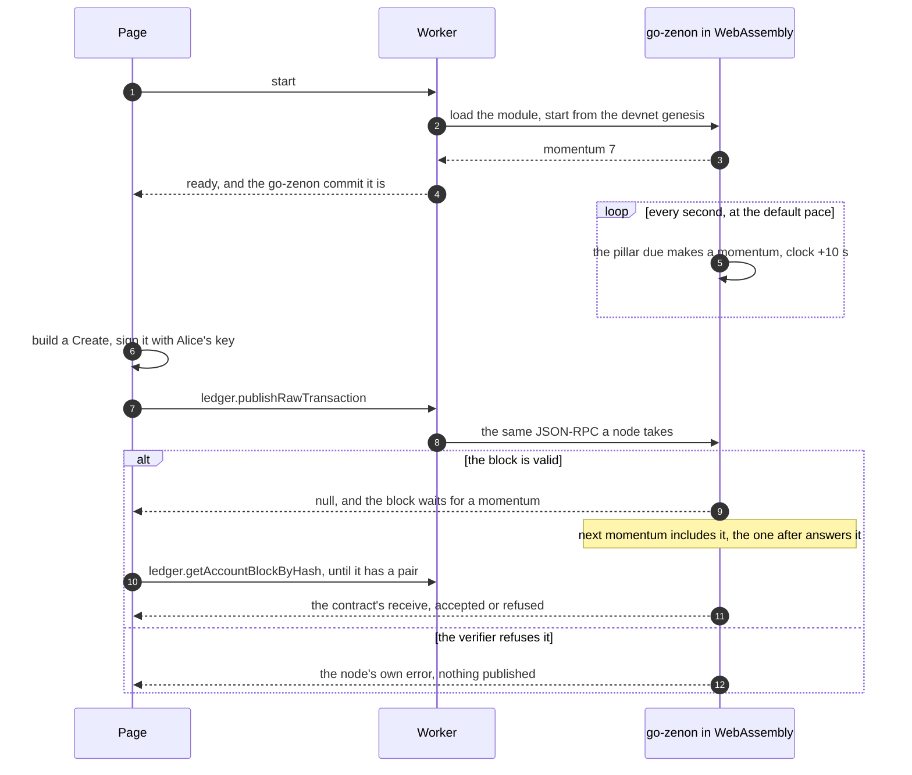
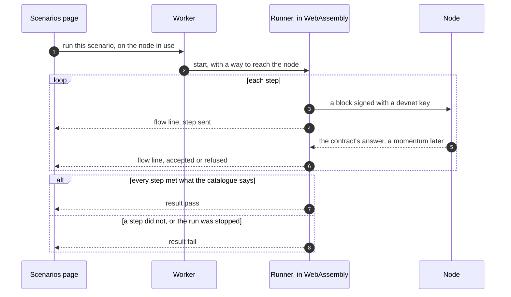

# ptlc-console

The console of the [zenon-ptlc](../zenon-ptlc) lab as a static page: every call the
ptlc contract has, signed by a key the page holds or by the Syrius extension, against a
node you pick or against a copy of the chain that runs in the tab. It is published to
GitHub Pages on every push to `master`.

The lab it comes from is a set of containers: a devnet, a bitcoind, and `labd`, a back
end that forwards RPC, runs `znn-cli` and runs the scenarios. A static page has none of
that. What replaces each part:

| In the lab | Here |
|---|---|
| `labd` forwards `/rpc` to its devnet | the page dials a node itself, over a WebSocket or HTTP |
| one fixed node | a node menu: the wallet's node, a devnet on this machine (the default), the chain in the page, or an address you type |
| the page compares Syrius's node with its own before signing | the page reads **Syrius's node** while Syrius is connected, so there is one chain and nothing to compare |
| `labd` runs the `flows` program for the scenarios page | the same Go program, compiled to WebAssembly, runs in the page |
| the devnet | optional. go-zenon's chain, virtual machine and contracts, compiled to WebAssembly and started from the devnet's genesis, run in a worker |
| bitcoind on regtest | a Bitcoin chain kept in the page: real transactions, btcd's real script engine, no blocks ([`sim/btc/chain.go`](sim/btc/chain.go)) |
| `znn-cli` | not here. A page cannot run a program; the lab at <https://ptlc.zenon.foo> does |

## Which node the page reads



**Devnet** is the default, `ws://127.0.0.1:35998`: the port a go-zenon devnet publishes its
WebSocket RPC on. A build for somewhere else sets `VITE_DEFAULT_NODE`.

**InPage** is the chain the page carries. The page moves there by itself in one case
only: the default did not answer and nobody ever picked anything. A visitor with no
node gets a page that works; a visitor who picked a node and finds it down is told so
and left where they chose to be.

**Picked** is the devnet, the chain in the page, or a typed address, kept in this
browser. **Wallet** is the address Syrius reports once the page is connected to it,
and it overrides the other three for as long as the connection lasts. After a
disconnect the page goes back to whatever was in force before; the diagram draws that
as Picked, which is the common case.

The reason the wallet wins is the same reason the lab refused to sign until it had
compared momentum hashes: Syrius publishes what it signs to its own node, every
go-zenon devnet is chain 69, and a page reading a different chain 69 would show a
`Create` as never arriving while the funds sat at an address nothing answers. Reading
the wallet's node removes the second chain instead of checking it.

Two limits follow from being a page:

- A page served over https may dial `wss://` anywhere and `ws://` only on the machine
  it runs on. A wallet whose node is `ws://` on another machine can sign, but this
  page cannot follow it, and says so rather than offering Syrius as a signer.
- Over HTTP the node must allow this page's origin (`HTTPCors`). Over a WebSocket it
  must allow it in `WSOrigins`, which go-zenon's devnet configs set to `*`.

Syrius cannot sign for the chain in the page: that chain is not a node a wallet can
dial. The keys the page holds can.

## A call, with no node anywhere



Nothing that answers in steps 9 to 11 is a model of the contract. It is `vm/embedded/implementation/ptlc.go`
from the commit [`go-zenon/PIN`](go-zenon/PIN) names, with go-zenon's verifier in front
of it and its pillars making the momentums. A block the page signs in JavaScript is
checked by the same code that checks it on a devnet, which is why a refusal here means
what it means there.

What is different from a node, all of it in [`sim/chain/chain.go`](sim/chain/chain.go)
and [`overlay/`](overlay/README.md):

- **No peers and no slots.** A momentum is made when the chain is told to make one.
  The default is one a second; the node menu has four a second, one every ten seconds
  as on a devnet, and stopped with a button for each.
- **The clock is the chain's.** Each momentum is ten seconds after the last whatever
  the pace, so a deadline four minutes out is twenty-four momentums away and passes in
  twenty-four seconds. The genesis is the devnet's, unchanged, stamped 2025-02-19, and
  the clock starts there. That is deliberate: go-zenon refuses a momentum stamped more
  than ten seconds ahead of the machine's clock, so a chain can run faster than real
  time only while its own clock is behind.
- **It is gone on reload.** It lives in the worker's memory, one chain for the
  document. The console and the scenarios page are that one document, so a scenario's
  blocks are on the console's tape and in its Entries bench.
- **The database is LevelDB over memory**, and two dependencies gained one file each to
  compile for a browser. [`overlay/README.md`](overlay/README.md) lists the four added
  files and what each does and does not touch.

## The scenarios page

`#/scenarios`: a card for each thing the contract can do, one **Run** button per card.
In the lab it is a document of its own, and in the first build here it was too. That
gave it a chain of its own in the page, which the console could not see, so it is now
a view of the console's document ([`web/src/Root.vue`](web/src/Root.vue)); the old
`./scenarios/` address redirects. While a scenario runs, the console does not sign as
Alice or Bob.
The runner is zenon-ptlc's `flows` program made into a package ([`sim/flows`](sim/flows)),
with its catalogue and its checks line for line; it signs every step with the devnet's
published keys.



**Node** is the chain in the same module when the page is on its own chain, and
otherwise the node in use, reached through the worker's own WebSocket or HTTP
connection. The runner is the same code against either.

The scenarios need a chain where the devnet's keys hold funds: a go-zenon devnet, or
the chain in the page. On anything else the page reads Alice's balance, finds nothing,
and holds every button with the reason. They sign with the devnet's keys whatever
wallet is connected; if one is, they run against its node like everything else.

On a devnet shared with other people (the public lab's, say) a run races everyone else
who signs as Alice and Bob. The runner retries a block that lost the race for an
account's next height, as it does in the lab.

## Build and run

Needs Go 1.23 or later, Node 22 or later, git, and for the browser check Chrome.

```sh
sh scripts/build-sim.sh          # fetch go-zenon at the pin, build web/src/sim/gen/ptlc.wasm
cd web
npm ci
npm run dev                      # http://localhost:5184
npm run build                    # web/dist, what Pages serves
```

`scripts/build-sim.sh` fetches go-zenon into `.build/`, checks its tree against
[`go-zenon/PIN`](go-zenon/PIN), and refuses to build from anything else. The module is
about 33 MB, 7.5 MB as a browser receives it compressed, and is fetched only when the
chain in the page or a scenario is first wanted.

## What is checked, and how

| Check | Command | What a pass means |
|---|---|---|
| The scenarios, natively | `go test ./...` in `sim/` | all twenty-one pass on the in-process chain; a stopped run fails; the Bitcoin chain holds a refund to its height |
| The module that ships | `node scripts/check-sim.mjs --all` | the same twenty-one in the built WebAssembly, under Node; a run through a transport function; stop and start |
| The page's own logic | `npm test` in `web/` | ABI, block hashing, the curve code against BIP-340's vectors, the run fold |
| The page, in a browser | `npm --prefix web run build:offline`, then `node e2e/check.mjs --all` | served under `/ptlc-console/` with a closed port as its default node: the page moves to its own chain, the Swap bench completes with blocks signed in JavaScript, every scenario is drawn to a pass, and the console's tape and Entries bench show what the scenarios did |
| The same, with a node | `node e2e/check.mjs --live ws://127.0.0.1:35998` | one scenario against that node from the page, and the wallet rule, with a stand-in for the provider |
| The diagrams | `node scripts/check-diagrams.mjs` | every Mermaid block in the repository's Markdown renders |

Run on 2026-10-10, 04:46 to 04:53 UTC, on Windows 11 with Go 1.27, Node 24 and Chrome:
all of the above passed, the live ones against the zenon-ptlc devnet on this machine.

**Not checked:** the real Syrius extension against this page. The adapter
([`web/src/wallet/syrius.ts`](web/src/wallet/syrius.ts)) is the lab's, which
zenon-ptlc's `lab/e2e/syrius.mjs` drives with the extension's own harness; what is new
here is that the page follows the wallet's node, and that rule was run with a stand-in
provider, not with the extension. The deploy workflow has not run either: it needs the
repository to exist on GitHub.

## Publishing

[`.github/workflows/pages.yml`](.github/workflows/pages.yml) builds the module, runs
the first two checks and the page's tests, builds the page and publishes `web/dist` on
every push to `master`. A failed check publishes nothing and leaves the page that was
up. Once, in the repository's settings: Pages, Source, **GitHub Actions**.

The build is relative (`base: './'`), so it works at `https://<user>.github.io/ptlc-console/`
and at the root of a domain without being told which.

## Moving to a newer contract

Set `BASE` and `TREE` in [`go-zenon/PIN`](go-zenon/PIN), copy any change to the
scenarios from zenon-ptlc's `scenarios/nom-to-btc` into `sim/` (the packages keep that
tree's names: `nom`, `adaptor`, `btc`, `keyswap`, `flows`, and `swap` for its `main.go`),
and run the checks above. The pin and the scenarios move together: the catalogue says
what the contract must answer, and a contract older than the catalogue fails it, as
the release-line patches did on `weak-key` when this was first built.

## Layout

```
go-zenon/PIN        the go-zenon commit and tree the chain is built from
overlay/            four files added to go-zenon and two dependencies, and why
scripts/            fetch and build the module; check it; check the diagrams
sim/                the Go module that becomes ptlc.wasm
  chain/            go-zenon's chain in one process, answering the node's RPC
  btc/              the Taproot swap output, and the Bitcoin chain in the page
  nom/ flows/ swap/ adaptor/ keyswap/    zenon-ptlc's scenarios, as packages
  cmd/wasm/         what the page calls
web/                the page (Vue, Vite): the console, and the scenarios at #/scenarios
  src/node/         which node, and the transports
  src/sim/          the worker that holds the module
e2e/                the browser check
```
